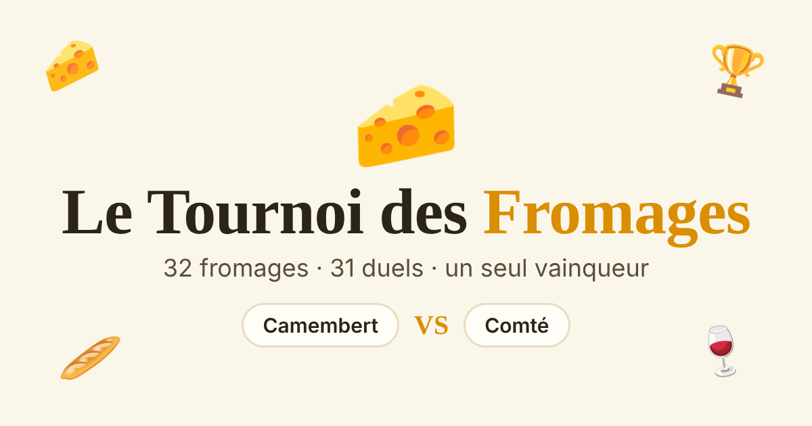

# 🧀 Le Tournoi des Fromages

> **32 fromages. 31 duels. Un seul vainqueur.**
> Découvre enfin ton fromage préféré, duel après duel.

👉 **[Jouer maintenant](https://clearnesss.github.io/tournoi-des-fromages/)**

---

## 🎮 Le principe

En France, il existe plus de 1 200 fromages (désolé mon Général, 246 c'était un peu juste 😏).
On a gardé les **32 plus connus et les plus vendus**, et on les fait s'affronter dans un vrai tableau à élimination directe :

| Tour | Duels |
|---|---|
| 🔔 Seizièmes de finale | 16 |
| 🥊 Huitièmes de finale | 8 |
| ⚔️ Quarts de finale | 4 |
| 🔥 Demi-finales | 2 |
| 👑 Grande finale | 1 |

À chaque duel, tu choisis ton préféré. Le perdant quitte le plateau. À la fin, il n'en reste qu'un. 🏆

## ⌨️ Comment jouer

- **Clic** sur le fromage de ton choix
- ou **←** pour celui de gauche, **→** pour celui de droite
- **↶ Oups, je me suis trompé** pour annuler le dernier choix
- **Voir le tableau** pour suivre tout le tournoi en direct

Le tirage est aléatoire : chaque partie est différente !

## ✨ Fonctionnalités

- Tirage au sort aléatoire à chaque partie
- Fiche pour chaque fromage : lait, type de pâte, région, description
- Tableau complet du tournoi, mis à jour en temps réel
- Podium final : vainqueur, finaliste, demi-finalistes et parcours du champion
- Pluie de fromages 🧀🥖🍷 pour célébrer le vainqueur
- Bouton pour partager ton verdict
- Jouable sur mobile comme sur ordinateur

## 🧀 Les 32 prétendants

Emmental · Camembert · Raclette · Comté · Brie de Meaux · Bûche de chèvre · Roquefort · Reblochon · Tomme de Savoie · Saint-Nectaire · Cantal · Mimolette · Munster · Morbier · Beaufort · Maroilles · Mozzarella · Feta · Coulommiers · Bleu d'Auvergne · Gruyère français · Fourme d'Ambert · Pont-l'Évêque · Livarot · Saint-Marcellin · Mont d'Or · Ossau-Iraty · Abondance · Chaource · Époisses · Neufchâtel · Crottin de Chavignol

Ton fromage favori n'est pas dans la liste ? Ouvre une *issue* pour plaider sa cause ! 🧑‍⚖️

## 🛠️ Technique

- Un seul fichier `index.html` : HTML, CSS et JavaScript, sans framework ni dépendance
- Illustrations des fromages dessinées en SVG
- Hébergé sur GitHub Pages

Pour lancer le jeu en local, ouvre simplement `index.html` dans ton navigateur.

## 🤝 Contribuer

Pour ajouter ou modifier un fromage, édite le tableau `CHEESES` dans `index.html`. Chaque fromage a un nom, une région, un type de lait, un type de pâte, une couleur, une forme d'illustration et une courte description.

Attention : le tableau doit contenir exactement **32 fromages** pour que le tournoi tombe juste.

---

Fait avec amour et beaucoup trop de fromage. 🧀
